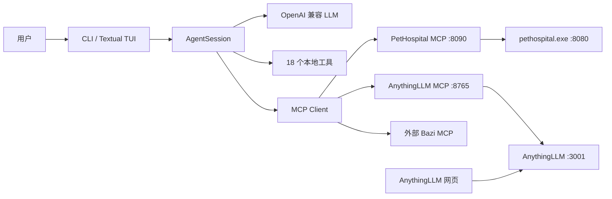

# study-project

本地 LLM 应用集合：宠物医院 MCP、AnythingLLM MCP、AnythingLLM 文档管理网页，以及一个带技能、MCP、AGENT.md 与会话恢复的终端 Agent。

> 仓库内不保存真实密钥、可执行文件、数据库和缓存。`config.ini` 由 `.gitignore` 忽略，仓库只交付 `config.example.ini` 与字段说明。

## 1. 项目地图

| 模块 | 目录 | 入口 | 一句话能力 |
| --- | --- | --- | --- |
| A. 宠物医院 MCP | `LLM/agent/office/pethospital-mcp/` | `server.py` | 把本地宠物医院 REST API 暴露为 10 个 MCP 工具，带参数约束、结构化错误、GET 退避重试。 |
| B. AnythingLLM MCP | `LLM/anytingLLM-MCP/` | `server.py` | 以 MCP 协议操作 AnythingLLM：列出工作区、读取文件、上传并向量化、检索问答。 |
| C. AnythingLLM 网页 | `LLM/anytingLLM-Web/` | `index.html` | 浏览器内管理 AnythingLLM 工作区文档：Key 输入、上传嵌入、列表、搜索、删除。 |
| D. 定制 Agent | `LLM/agent/two/` | `xAgent/__main__.py`、`tui/app.py` | 18 个本地工具 + 动态 MCP 工具，支持技能创建/加载、AGENT.md、上下文压缩、会话恢复与 TUI。 |
| 上游宠物医院 | `study one-pethospital/` | `pethospital.exe` | 宠物医院 REST 服务（8080）及发行说明；Go 上游源码不随本仓库交付。 |
| 课程基础练习 | `LLM/agent/one/` | `main.py`、`main-stream-loop.py` | 早期流式对话示例，不属于 A–D 主模块。 |
| 工作区配置 | `LLM/agent/office/` | `.mcp.json`、`start-mcp.ps1` | Agent 的 MCP 清单与三服务一键启动脚本。 |

```text
study-project/
├── README.md
├── .github/workflows/tests.yml
├── tests/                              # 根级 unittest（时间、技能、边界、循环、会话、MCP）
├── LLM/
│   ├── agent/
│   │   ├── one/                        # 基础流式对话练习
│   │   ├── two/                        # D：xAgent + Textual TUI
│   │   │   ├── xAgent/
│   │   │   │   ├── agent.py            # AgentSession / CLI
│   │   │   │   ├── settings.py         # config.ini 定位与 [agent] 默认值
│   │   │   │   ├── agent_md.py         # AGENT.md 读取、截断、注入
│   │   │   │   ├── skills.py           # 技能发现、渐进注入、loadSkill 读取
│   │   │   │   ├── sessions.py         # .agents/sessions/*.jsonl 持久化
│   │   │   │   ├── mcp_client.py       # MCP 客户端与来源前缀
│   │   │   │   ├── logger.py           # 统一最小日志
│   │   │   │   ├── tools/              # 18 个本地工具
│   │   │   │   └── scripts/validate_skills.py
│   │   │   ├── tui/                    # Textual 界面
│   │   │   └── config.example.ini
│   │   └── office/                     # MCP 清单、启动脚本、宠物医院 MCP
│   ├── anytingLLM-MCP/                 # B：AnythingLLM MCP
│   └── anytingLLM-Web/                 # C：静态网页
└── study one-pethospital/              # 上游发行包说明与辅助脚本
```

## 2. 模块关系



- `AgentSession` 只负责消息、工具循环、上下文和持久化；CLI/TUI 只消费事件，不重复业务逻辑。
- MCP 工具在启动时发现，统一暴露为 `<server>__<tool>`，描述前缀 `[MCP:<server>]`；单个 Server 失败只记录错误，不阻塞本地工具。
- 宠物医院 MCP 与 AnythingLLM MCP 都是独立进程，Agent 通过 `.mcp.json` 连接。
- 网页与 MCP 共享同一个 AnythingLLM REST API，但网页不经过 Agent。

## 3. 环境与依赖

已验证环境：

| 依赖 | 版本/说明 |
| --- | --- |
| OS | Windows 11（PowerShell 5.1+）；MCP Server 本身只用 Python 标准库 |
| Python | **3.13.7**（要求 3.13+） |
| `mcp` | 2.3.0（`mcp>=2.3.0,<3`） |
| `httpx2` | 2.16.0（`mcp` 的 Streamable HTTP 客户端依赖） |
| `requests` | 2.31+ |
| `trafilatura` | 1.6+（网页正文提取） |
| `textual` | 8.0+（TUI） |
| AnythingLLM | 需另行安装并运行在 `http://localhost:3001`，在设置中生成 API Key |
| 宠物医院 | `study one-pethospital/pethospital.exe`（发行包，未入库） |

安装：

```powershell
python -m pip install -r LLM/agent/two/xAgent/requirements.txt
python -m pip install -r LLM/agent/two/requirements.txt
```

`LLM/anytingLLM-MCP/server.py`、`LLM/agent/office/pethospital-mcp/server.py` 和网页均不需要额外 Python 包。

## 4. 配置

### 4.1 Agent 配置

```powershell
Copy-Item LLM/agent/two/xAgent/config.example.ini LLM/agent/two/config.ini
```

`config.ini` 已被 `.gitignore` 忽略。Agent 查找顺序：显式路径 → 当前工作目录 `config.ini` → `LLM/agent/two/config.ini`。

| 小节 | 字段 | 默认值 | 真实行为 |
| --- | --- | --- | --- |
| `[llm]` | `base_url` | 模板示例 | OpenAI 兼容的 `/chat/completions` 基址。 |
| `[llm]` | `api_key` | 无 | 调用 LLM 的 Bearer Key，仅放本地 `config.ini`。 |
| `[llm]` | `model` | 模板示例 | 请求体 `model`。 |
| `[llm]` | `context_window` | `65536` | 上下文阈值计算；达到阈值后阻塞并要求 `/compact`。 |
| `[search]` | `baidu_qianfan_api_key` | 空 | `searchWeb` 的鉴权 Key；为空时返回明确配置错误。 |
| `[agent]` | `agent_file` | `AGENT.md` | 工作目录规则文件名；不存在时尝试 `AGENTS.md`。 |
| `[agent]` | `agent_file_enabled` | `true` | 关闭后不读取、不注入。 |
| `[agent]` | `agent_file_max_chars` | `8000` | 超出后截断并追加 `（已截断）`。 |
| `[agent]` | `workspace_allow_outside` | `false` | 允许文件工具操作工作目录之外；默认拒绝。 |
| `[agent]` | `max_steps` | `20` | 单轮最多模型请求步数。 |
| `[agent]` | `turn_timeout` | `300` | 单轮总超时（秒）。 |
| `[agent]` | `skill_max_chars` | `50000` | `loadSkill` 单文件读取上限。 |

### 4.2 AnythingLLM MCP

| 环境变量 | 默认值 | 说明 |
| --- | --- | --- |
| `ANYTHINGLLM_API_KEY` | **无默认值，必须设置** | 缺失时服务仍启动，但所有 `tools/call` 返回 `isError:true`，且不会访问上游。 |
| `ANYTHINGLLM_URL` | `http://localhost:3001` | AnythingLLM 地址。 |
| `MCP_HOST` | `127.0.0.1` | 监听地址。 |
| `MCP_PORT` | `8765` | 监听端口。 |

```powershell
$env:ANYTHINGLLM_API_KEY = "在 AnythingLLM 设置中生成的 Key"
python LLM/anytingLLM-MCP/server.py
```

### 4.3 宠物医院 MCP

| 环境变量 | 默认值 |
| --- | --- |
| `PET_HOSPITAL_URL` | `http://127.0.0.1:8080` |
| `MCP_HOST` | `127.0.0.1` |
| `MCP_PORT` | `8090` |

### 4.4 网页 Key

`LLM/anytingLLM-Web/index.html` 不含任何密钥。打开页面后在顶部输入 AnythingLLM API Key，点击“保存”；Key 只写入当前浏览器 `localStorage`，可“清除”。未配置时上传、刷新、工作区选择全部禁用，并显示红色错误。

### 4.5 MCP 客户端清单

`LLM/agent/office/.mcp.json`：

```json
{
  "mcpServers": {
    "Bazi-MCP": {
      "type": "streamable_http",
      "url": "https://mcp.api-inference.modelscope.net/af66872638854d/mcp"
    },
    "PetHospitalMCP": {
      "type": "streamable_http",
      "url": "http://127.0.0.1:8090/mcp"
    },
    "AnythingLLMMCP": {
      "type": "streamable_http",
      "url": "http://127.0.0.1:8765/mcp"
    }
  }
}
```

也支持 `stdio`：`{"type":"stdio","command":"python","args":["server.py"],"env":{...}}`。单个 Server 连不上时，Agent 启动继续，错误在 stderr 与工具列表中可见。

## 5. 分步启动

以下命令均从仓库根目录执行。

### 第 1 步：启动宠物医院 REST（A 的上游）

```powershell
Start-Process -FilePath "study one-pethospital\pethospital.exe" -ArgumentList "-no-color"
```

验证：浏览器打开 <http://127.0.0.1:8080/>，或 `curl http://127.0.0.1:8080/health`。

> 该 exe 来自上游发行包，未提交到 Git；没有它时宠物医院 MCP 仍可启动，但业务调用会返回 `PET_UNAVAILABLE`。

### 第 2 步：启动 MCP 服务

```powershell
$env:ANYTHINGLLM_API_KEY = "你的 AnythingLLM Key"   # 不设置则 AnythingLLM 工具返回 isError
powershell -ExecutionPolicy Bypass -File LLM/agent/office/start-mcp.ps1
```

脚本根据自身位置推导仓库根目录，不再依赖固定 `D:\study` 路径；会跳过已在监听端口上的服务，并检查宠物医院 exe 是否存在。

手动分别启动：

```powershell
python LLM/agent/office/pethospital-mcp/server.py   # :8090/mcp
python LLM/anytingLLM-MCP/server.py                 # :8765/mcp
```

### 第 3 步：启动 Agent

要让 Agent 读取 `LLM/agent/office/.mcp.json` 与 office 下的技能，工作目录必须是 `LLM/agent/office`：

```powershell
cd LLM/agent/office
$env:PYTHONPATH = (Resolve-Path '..\two').Path
python -m xAgent          # 最小 CLI
python -m tui             # Textual TUI
```

`config.ini` 仍从 `LLM/agent/two/config.ini` 读取。仅使用本地工具、不接入 office MCP/技能时，也可以直接 `cd LLM/agent/two` 后运行同一命令。

从 `LLM/agent/two` 还可以运行 `python chat-stream-tool-files.py`（TUI 入口）或 `python chat-stream-tool-isLeapYear.py`（闰年示例）。

### 第 4 步：打开 AnythingLLM 网页

直接双击 `LLM/anytingLLM-Web/index.html`，或从仓库根目录启静态服务：

```powershell
python -m http.server 8000 --directory LLM/anytingLLM-Web
```

打开 <http://127.0.0.1:8000/>。若浏览器因跨域拒绝访问 `localhost:3001`，请用 AnythingLLM 允许的来源启动静态服务，或把页面放到同源服务下。

## 6. 每个模块一句话

- **A 宠物医院 MCP**：10 个 `pet_*` 工具，输入有 enum/range/required 约束，错误统一为 `PET_*` 结构化对象，GET 失败指数退避重试一次。
- **B AnythingLLM MCP**：5 个工具覆盖工作区列举、文件读取、上传+向量化、检索问答，Key 缺失时明确报错且不请求上游。
- **C AnythingLLM 网页**：真实调用工作区/上传/更新向量接口，Key 仅存浏览器，上传与删除都有进行中/成功/失败状态。
- **D xAgent**：18 个本地工具，技能按需加载，MCP 动态接入，AGENT.md 注入，会话 JSONL 持久化，TUI 与 CLI 共用同一会话层。

## 7. 验证清单

### 7.1 静态检查与单测

```powershell
python -m compileall LLM/agent/two/xAgent LLM/anytingLLM-MCP LLM/agent/office/pethospital-mcp
python -m unittest discover -s tests
```

预期：`compileall` 无 SyntaxError；unittest 以 `OK` 结束（当前 61 个测试）。

### 7.2 技能校验

```powershell
python LLM/agent/two/xAgent/scripts/validate_skills.py --root LLM/agent/office
```

预期：`校验完成：0 个错误...`，退出码 0。

### 7.3 MCP 冒烟（宠物医院）

先启动宠物医院与 8090 MCP：

```bash
curl -sS -X POST http://127.0.0.1:8090/mcp \
  -H 'Content-Type: application/json' \
  -d '{"jsonrpc":"2.0","id":1,"method":"initialize","params":{"protocolVersion":"2025-03-26"}}'

curl -sS -X POST http://127.0.0.1:8090/mcp \
  -H 'Content-Type: application/json' \
  -d '{"jsonrpc":"2.0","id":2,"method":"tools/list","params":{}}'

curl -sS -X POST http://127.0.0.1:8090/mcp \
  -H 'Content-Type: application/json' \
  -d '{"jsonrpc":"2.0","id":3,"method":"tools/call","params":{"name":"pet_stats","arguments":{"top":5}}}'
```

预期：`initialize` 返回 `protocolVersion` 与 `serverInfo`；`tools/list` 返回 10 个 `pet_*`；`tools/call` 返回 `structuredContent`，`isError:false`。关闭宠物医院后再调用，应返回 `PET_UNAVAILABLE`。

### 7.4 MCP 冒烟（AnythingLLM，缺 Key 场景）

在**未设置** `ANYTHINGLLM_API_KEY` 的终端启动 8765 后：

```bash
curl -sS -X POST http://127.0.0.1:8765/mcp \
  -H 'Content-Type: application/json' \
  -d '{"jsonrpc":"2.0","id":1,"method":"tools/call","params":{"name":"list_workspaces","arguments":{}}}'
```

预期：`result.isError == true`，`content[0].text` 含 `未配置 ANYTHINGLLM_API_KEY`，且上游 AnythingLLM 没有收到请求。

设置 Key 后再次调用，应返回工作区列表；`upload_document` 可用 `file_path` 上传并返回 `embedded:true`；`ask_workspace` 返回 `textResponse` 与 `sources`。

### 7.5 网页验收

1. 清除 localStorage 后刷新：顶部显示“未配置，所有操作已禁用”，上传/刷新/工作区选择灰掉，列表区显示配置错误。
2. 输入 Key 保存：加载工作区，文件列表来自 `GET /api/v1/workspace/{slug}`。
3. 选择文件上传：目标工作区收到文件，`update-embeddings` 成功，列表高亮新文件。
4. 点击删除并确认：调用 `update-embeddings` 的 `deletes`，文件从列表消失。
5. 浏览器开发者工具搜索源码，不应出现 `Bearer <真实Key>` 或硬编码 Key。

### 7.6 密钥自检

```bash
grep -rn "EPHZ30T\|sk-\|Bearer [A-Za-z0-9]" LLM/anytingLLM-Web LLM/anytingLLM-MCP
```

预期：无输出。

## 8. 架构与关键决策

- **分层**：配置 `settings.py` → 工具 `tools/` → 会话 `agent.py` → 界面 `tui/`。MCP Server 与网页是独立边界，不把业务逻辑塞进 UI。
- **安全默认值**：文件写/删/改名默认限制在工作目录，破坏性操作必须 `confirm=true`；MCP 密钥只从环境变量读取；网页 Key 只进 localStorage。
- **渐进加载**：技能启动时只解析 frontmatter 的 `name`/`description`，正文由 `loadSkill` 按需读取并限制 50000 字符。
- **会话一致性**：每次保存写 meta（创建时间、cwd、模型、消息数、token/usage），恢复时重建唯一 system 提示，避免 AGENT.md 与技能重复注入。
- **失败降级**：MCP Server 发现失败只记录 `errors` 并继续；LLM/工具异常回填为 tool 消息，循环可继续；达到步数/超时后追加系统提示并返回控制权。
- **可复现**：MCP Server 仅标准库；Python 依赖集中声明；配置用模板 + 字段表；测试覆盖关键边界。

## 9. 第三方与上游说明

- `LLM/agent/office/.agents/skills/officecli/` 与 `LLM/agent/office/OfficeCli_#SULP#_26sc1d/` 是随课程资料提供的第三方 OfficeCli 产物，本仓库未修改其 `SKILL.md`/`reference.md`；详见 `LLM/agent/office/NOTICE.md`。
- `study one-pethospital/` 只包含上游发行包说明与辅助脚本；Go 源码（`main.go`、`internal/` 等）不在本仓库，构建/交叉编译命令仅适用于上游源码。
- `LLM/agent/one/` 是课程基础练习，不参与 A–D 评分模块。

## 10. 仓库卫生

- 不提交 `config.ini`、`*.local.ini`、`*.exe`、`*.db`、`*.pyc`、`__pycache__/`、会话 JSONL、测试缓存。
- 提交前检查：`git status --short`、`git diff --cached --stat`。
- 不执行 `git push`；发布前由维护者确认。
